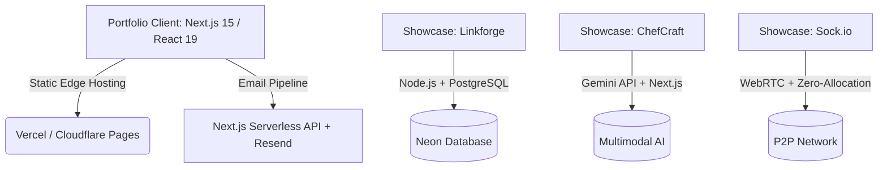

# Sumeet Kanhiya — Luxury Portfolio & Systems Architect

A high-performance, interactive portfolio showcasing distributed systems, high-throughput web applications, and AI integrations. Built as a static Next.js application, featuring a "Pure Void" luxury dark theme with bespoke Framer Motion physics and magnetic micro-interactions.

---

## 🏗️ Architecture Overview

The portfolio is structured as a frontend-only, edge-optimized static site. It emphasizes precise interfaces and resilient infrastructure over boilerplate.



### Technical Stack
- **Framework**: Next.js 15 (App Router) & React 19.
- **Rendering**: Static Site Generation (SSG) with serverless route handlers.
- **Styling**: Tailwind CSS v4 & Vanilla CSS.
- **Interactivity**: Framer Motion for spring physics, gamified cursors, and magnetic CTA buttons.
- **Typography**: Inter (Display) & JetBrains Mono (Code/Body) for a technical, developer-first aesthetic.

---

## ⚡ Technical Highlights

This repository demonstrates high-end UI engineering and systems architecture:

### 1. Luxury "Pure Void" Aesthetic
- Stripped-back, ultra-dark obsidian background (`#0e0e10`) layered with an SVG fractal noise grain overlay.
- Zero-cost performance texture that eliminates flat, sterile backgrounds using `mix-blend-mode: overlay`.

### 2. Gamified Cursor & Magnetic Buttons
- Custom `CursorOrb` component tracking the global mouse position using Framer Motion springs (`damping: 40`, `stiffness: 120`) for an elastic lag effect.
- The orb uses `mix-blend-mode: screen` to illuminate the massive hero typography from behind.
- `MagneticButton` CTAs that subtly pull toward the user's cursor (`0.35` pull factor) paired with tactile audio feedback via `useSound`.

### 3. Asymmetric Bento Grid with Mouse-Tracking Glow
- A responsive, asymmetrical project grid showcasing real-world applications.
- Each `BentoCard` computes cursor position relative to its bounds, driving a precise CSS radial gradient glow using custom CSS variables (`--mouse-x`, `--mouse-y`).

### 4. Anti-Parallel Infinite Marquees
- CSS-only, dual-row infinite scrolling tech stack marquees.
- Row 1 scrolls left, Row 2 scrolls right in opposite directions.
- Features editorial brutalist outlined typography (`-webkit-text-stroke`) for high visual impact without JS overhead.

### 5. Interactive Bash Terminal Contact Mode
- An alternative contact form simulating a Linux bash environment.
- Supports commands: `help`, `whoami`, `ls`, `projects`, `resume`, and `clear`.
- Form validation handled via React Hook Form and Zod schema.

---

## 🚀 Getting Started (Local Development)

### 1. Installation
Clone the repository and install the dependencies in the frontend directory:
```bash
cd frontend
npm install
```

### 2. Environment Variables
Create a `.env` file inside the `frontend/` directory:
```env
# Resend API Key for Next.js contact route
RESEND_API_KEY="your-resend-api-key"
```

### 3. Running the App
Spin up the Next.js development server:
```bash
npm run dev
```
The site will start at [http://localhost:3000](http://localhost:3000).

### 4. Build Commands
- `npm run typecheck` — Run TypeScript compilation checks.
- `npm run build` — Build the production static bundle.
- `npm run start` — Run the built server.
