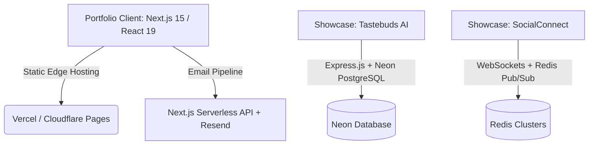

# Sumeet Kanhiya — Full Stack & Backend Portfolio

A high-performance, interactive portfolio showcasing 3D WebGL interfaces, real-time WebSocket platforms, and Edge API deployments. Built entirely as a static Next.js application optimized for speed, reliability, and zero-cost edge hosting.

---

## 🏗️ Architecture Overview

The portfolio is structured as a frontend-only, edge-optimized static site. The engineering proof for backend and system design lives in the respective showcase repositories.



### Technical Stack
- **Framework**: Next.js 15 (App Router) & React 19.
- **Rendering**: Static Site Generation (SSG) with serverless route handlers.
- **Styling**: Tailwind CSS & Vanilla CSS with custom cohesive animations.
- **Interactivity**: Framer Motion for orchestrating staggered entrance elements and React Three Fiber / WebGL for particle dynamics.

---

## ⚡ Technical Highlights (Remediation Actions)

This repository demonstrates high-end engineering practices across several core modules:

### 1. WebGL 3D Particle Canvas
- Implemented using `@react-three/fiber` and `@react-three/drei`.
- Renders a responsive, interactive particle system acting as a background, with scroll-linked coordinate shifting and frame-rate optimizations.

### 2. Interactive Bash Terminal Contact Mode
- An alternative contact form simulating a Linux bash environment.
- Supports commands: `help`, `whoami` (bio), `ls` (section links), `projects` (showcase overview), `resume` (PDF view), and `clear`.
- Form validation handled via React Hook Form and Zod schema.

### 3. Print-Optimized Resume Engine
- Built directly in React with custom `@media print` CSS stylesheet rules (under 17KB) ensuring zero formatting breaks on print/PDF outputs.
- Includes an export to PDF feature using `jspdf` and `html2canvas-pro` without compromising layout.

### 4. Edge-Deployed Showcase (Linkforge)
- Next.js Edge Runtime redirect engine with sub-25ms latency.
- Implements PostgreSQL connection pooling via Neon serverless driver and Stale-While-Revalidate (SWR) caching to mitigate cold starts and database load.

---

## 🚀 Getting Started (Local Development)

### 1. Installation
Clone the repository and install the dependencies:
```bash
npm install
```

### 2. Environment Variables
Create a `.env` file inside the `frontend/` directory:
```env
# Resend API Key for Next.js contact route
RESEND_API_KEY="your-resend-api-key"
```

### 3. Running the App
Spin up the Next.js development server:
```bash
npm run dev
```
The site will start at [http://localhost:3000](http://localhost:3000).
